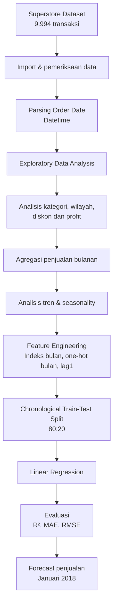

# 📊 Day 49 — Capstone Project: Retail Sales Analysis & Prediction

<p align="center">
  <strong>Retail Sales Analysis & Prediction</strong><br>
  Analisis performa penjualan ritel, profitabilitas, pola musiman, dan prediksi penjualan bulanan menggunakan Machine Learning.
</p>

<p align="center">
  
  
  
  
</p>

## 📌 1. Gambaran Proyek

Proyek ini merupakan capstone project analisis data ritel menggunakan **Superstore Dataset**. Dalam proyek ini, analisis dilakukan dari sudut pandang seorang analis data di perusahaan ritel untuk memahami performa penjualan historis, menemukan faktor yang berhubungan dengan profitabilitas, mengidentifikasi tren dan pola musiman, serta membangun model sederhana untuk memprediksi penjualan bulan berikutnya.

Analisis mencakup performa penjualan dan profit berdasarkan kategori produk dan wilayah, hubungan antara diskon dengan profit, agregasi penjualan bulanan, hingga pemodelan *time series* menggunakan **Linear Regression**.

Tujuan akhirnya adalah menghasilkan insight yang dapat membantu perencanaan stok, strategi diskon, pemasaran, anggaran, dan target penjualan.

## 🎯 2. Tujuan Pembelajaran

- Melakukan Exploratory Data Analysis (EDA) terhadap data transaksi ritel.
- Memahami distribusi dan karakteristik variabel penjualan, profit, quantity, serta discount.
- Mengubah kolom tanggal menjadi tipe datetime dan melakukan agregasi penjualan bulanan.
- Menganalisis penjualan dan profit berdasarkan kategori produk serta wilayah.
- Mengidentifikasi hubungan antara tingkat diskon dan profitabilitas.
- Mengamati tren penjualan dan pola musiman berdasarkan bulan kalender.
- Membuat fitur prediktif berupa indeks bulan, bulan kalender, dan lag penjualan.
- Melatih model Linear Regression dengan pembagian data secara kronologis.
- Mengevaluasi model menggunakan R², MAE, dan RMSE.
- Menghasilkan prediksi penjualan untuk satu bulan setelah periode historis terakhir.
- Menyusun insight dan rekomendasi bisnis berdasarkan hasil analisis.

## 📂 3. Dataset

**Superstore Dataset**

Dataset berisi transaksi sebuah perusahaan ritel di Amerika Serikat selama periode 2014–2017.

| Informasi | Detail |
|---|---|
| Sumber | [Kaggle — Superstore Dataset Final](https://www.kaggle.com/datasets/vivek468/superstore-dataset-final) |
| File utama | `Sample - Superstore.csv` |
| Jumlah transaksi | 9.994 baris |
| Jumlah kolom | 21 kolom |
| Periode data setelah parsing tanggal | 3 Januari 2014 – 30 Desember 2017 |
| Encoding | `latin-1` |
| Mata uang pada data | USD |

### Kolom yang relevan

| Kolom | Deskripsi |
|---|---|
| `Order Date` | Tanggal pemesanan |
| `Ship Date` | Tanggal pengiriman |
| `Ship Mode` | Metode pengiriman |
| `Segment` | Segmen pelanggan |
| `Country`, `City`, `State` | Informasi geografis |
| `Region` | Wilayah penjualan |
| `Category` | Kategori produk |
| `Sub-Category` | Sub-kategori produk |
| `Product Name` | Nama produk |
| `Sales` | Nilai penjualan (USD) |
| `Quantity` | Jumlah unit yang dibeli |
| `Discount` | Tingkat diskon |
| `Profit` | Keuntungan transaksi (USD) |

Notebook memuat seluruh 21 kolom dataset, sedangkan analisis berfokus pada kolom-kolom yang relevan dengan waktu, kategori, wilayah, penjualan, diskon, dan profit.

## 🧰 4. Teknologi dan Library

| Teknologi / Library | Peran |
|---|---|
| Python | Bahasa pemrograman |
| Pandas | Membaca, membersihkan, mengolah, dan mengagregasi data |
| NumPy | Operasi numerik dan pembuatan fitur |
| Matplotlib | Visualisasi data |
| Seaborn | Visualisasi statistik |
| Scikit-learn `LinearRegression` | Model regresi untuk prediksi penjualan |
| Scikit-learn `mean_absolute_error` | Menghitung MAE |
| Scikit-learn `mean_squared_error` | Menghitung MSE sebagai dasar perhitungan RMSE |
| Scikit-learn `r2_score` | Mengukur kemampuan model menjelaskan variasi target |

## ⚙️ 5. Alur Pengerjaan

### 🔄 Ringkasan pipeline



### 5.1 Import dan Pemeriksaan Dataset

Dataset dibaca menggunakan Pandas dengan encoding `latin-1`.

```python
df = pd.read_csv("Sample - Superstore.csv", encoding="latin-1")
```

Pemeriksaan awal dilakukan menggunakan `head()`, `info()`, dan statistik deskriptif untuk memahami struktur serta karakteristik data.

Hasil pemeriksaan:

| Pemeriksaan | Hasil |
|---|---:|
| Jumlah baris | 9.994 |
| Jumlah kolom | 21 |
| Missing values | 0 |
| Rentang tanggal setelah parsing | 2014–2017 |

Statistik deskriptif beberapa variabel numerik:

| Variabel | Mean | Median | Minimum | Maksimum |
|---|---:|---:|---:|---:|
| Sales | 229,86 | 54,49 | 0,444 | 22.638,48 |
| Profit | 28,66 | 8,67 | -6.599,978 | 8.399,976 |
| Quantity | 3,79 | 3 | 1 | 14 |
| Discount | 0,156 | 0,20 | 0 | 0,80 |

**Interpretasi:**

- Nilai rata-rata Sales lebih besar daripada median, menunjukkan adanya transaksi bernilai tinggi yang memengaruhi distribusi.
- Profit memiliki nilai minimum negatif yang menunjukkan adanya transaksi merugi.
- Rata-rata Quantity sekitar 3–4 unit per transaksi.
- Diskon rata-rata sekitar 15,6%, dengan diskon maksimum 80%.

### 5.2 Cleaning dan Parsing Tanggal

Kolom `Order Date` yang awalnya berupa teks diubah menjadi tipe `datetime` menggunakan format `%m/%d/%Y`.

Kemudian dibuat beberapa kolom bantu:

- `Bulan`: tanggal awal bulan untuk agregasi bulanan.
- `Tahun`: tahun transaksi.
- `NamaBulan`: nomor bulan kalender (1–12).

Hasil parsing menunjukkan rentang tanggal **3 Januari 2014 sampai 30 Desember 2017**. Kolom `Bulan` menjadi dasar analisis tren dan pemodelan deret waktu.

### 5.3 Exploratory Data Analysis (EDA)

EDA dilakukan untuk memahami sumber penjualan dan profitabilitas bisnis melalui beberapa analisis.

#### a. Sales dan Profit berdasarkan Category

Penjualan dan profit dikelompokkan berdasarkan kategori produk. Selain nilai absolut, dihitung pula persentase profit terhadap sales:

```python
cat["% Profit"] = cat["Profit"] / cat["Sales"] * 100
```

Hasil agregasi:

| Category | Sales (USD) | Profit (USD) | Profit Margin |
|---|---:|---:|---:|
| Technology | 836.154,03 | 145.454,95 | 17,39% |
| Furniture | 741.999,80 | 18.451,27 | 2,49% |
| Office Supplies | 719.047,03 | 122.490,80 | 17,04% |

**Temuan utama:**

- **Technology** memiliki total sales dan profit terbesar, sekaligus profit margin tertinggi sebesar 17,39%.
- **Office Supplies** memiliki sales paling rendah di antara ketiga kategori, tetapi profit margin tetap tinggi, yaitu 17,04%.
- **Furniture** menghasilkan sales yang besar, tetapi profit margin hanya 2,49%. Kategori ini perlu mendapat perhatian karena nilai penjualannya belum diikuti keuntungan yang sebanding.

#### b. Profit berdasarkan Region

Profit dikelompokkan berdasarkan wilayah penjualan.

| Region | Total Profit (USD) |
|---|---:|
| West | 108.418,45 |
| East | 91.522,78 |
| South | 46.749,43 |
| Central | 39.706,36 |

**Temuan utama:**

- West menjadi wilayah dengan profit tertinggi.
- East berada di posisi kedua dengan kontribusi profit yang kuat.
- South dan Central menghasilkan profit jauh lebih rendah dibandingkan West dan East.
- Perbedaan ini dapat menjadi dasar evaluasi strategi pemasaran dan efisiensi operasional per wilayah.

#### c. Hubungan Discount dan Profit

Hubungan antara diskon dan profit dianalisis menggunakan scatter plot dengan sampel 2.000 transaksi. Garis horizontal pada profit nol digunakan sebagai titik impas, sedangkan area diskon 30%–80% ditandai sebagai zona berisiko tinggi.

**Temuan dari visualisasi dan interpretasi notebook:**

- Pada diskon 0%–20%, sebagian besar transaksi berada pada area profit positif.
- Mulai diskon 30% ke atas, banyak transaksi berada di sekitar titik impas atau menghasilkan kerugian.
- Diskon tinggi, terutama pada kisaran 50%, 70%, dan 80%, berkaitan dengan kerugian yang dapat mendekati -$4.000 per transaksi.

**Rekomendasi awal:** Kebijakan diskon perlu dikendalikan. Notebook menyarankan batas diskon maksimal 20%, dengan pengecualian yang memerlukan persetujuan manajemen.

### 5.4 Monthly Sales Aggregation dan Analisis Tren

Data transaksi diringkas menjadi total `Sales` per bulan:

```python
monthly_sales = data.groupby("Bulan")["Sales"].sum().reset_index()
monthly_sales = monthly_sales.sort_values("Bulan").reset_index(drop=True)
```

Visualisasi tren menggunakan:

- Garis penjualan bulanan aktual.
- Moving Average 3 bulan (MA3) untuk membantu melihat arah tren dengan mengurangi fluktuasi jangka pendek.

**Temuan utama:**

- Penjualan bulanan mengalami fluktuasi yang cukup tajam.
- Secara umum, interpretasi notebook menunjukkan kecenderungan pertumbuhan dalam periode 2014–2017.
- Terdapat lonjakan penjualan menjelang akhir tahun.
- Pada penghujung 2017, penjualan bulanan mencapai hampir $120.000.

MA3 membantu memperjelas arah tren di tengah fluktuasi penjualan bulanan.

### 5.5 Seasonal Pattern: Penjualan berdasarkan Bulan Kalender

Total penjualan dikelompokkan berdasarkan nama/nomor bulan kalender untuk menggabungkan bulan yang sama dari seluruh tahun pengamatan.

Ringkasan hasil yang dicatat dalam notebook:

| Bulan | Total Sales (USD) |
|---|---:|
| Januari | 94.925 |
| Februari | 59.751 |
| Maret | 205.005 |
| April–Agustus | Sekitar 137.000–159.000 per bulan |
| September | 307.650 |
| Oktober | 200.323 |
| November | 352.461 |
| Desember | 325.294 |

**Temuan utama:**

- Februari merupakan bulan dengan total penjualan terendah, disusul Januari.
- Penjualan meningkat tajam pada Maret.
- April hingga Agustus relatif lebih stabil.
- September hingga Desember menunjukkan peningkatan aktivitas penjualan.
- November menjadi bulan dengan total penjualan tertinggi.

**Kesimpulan:** Dataset memperlihatkan pola musiman ritel yang kuat pada kuartal akhir (Q4). Perencanaan inventaris dan kampanye pemasaran perlu mempertimbangkan peningkatan permintaan pada periode tersebut.

### 5.6 Feature Engineering untuk Prediksi

Sebelum model dilatih, data bulanan diubah menjadi fitur numerik.

Fitur yang digunakan:

| Fitur | Fungsi |
|---|---|
| `mon_indx` | Indeks berurutan untuk menangkap tren waktu |
| `m_1` sampai `m_12` | One-hot encoding bulan kalender untuk menangkap pola musiman |
| `lag1` | Total sales pada bulan sebelumnya |

Kolom `lag1` dibuat dengan menggeser nilai penjualan satu periode:

```python
ts["lag1"] = ts["Sales"].shift(1)
```

Baris pertama kemudian dihapus karena tidak memiliki nilai penjualan bulan sebelumnya. Setelah proses ini, data yang tersedia untuk pemodelan berjumlah **47 bulan**.

### 5.7 Modeling: Linear Regression

Model yang digunakan adalah **Linear Regression** dari Scikit-learn.

Pembagian data dilakukan secara kronologis dengan rasio 80:20. Data bulan-bulan awal digunakan untuk training, sedangkan bulan-bulan terakhir digunakan untuk testing.

Pembagian kronologis dipilih agar data masa depan tidak masuk ke proses pelatihan dan mengurangi risiko data leakage pada evaluasi deret waktu.

| Bagian | Jumlah Bulan |
|---|---:|
| Training | 37 |
| Testing | 10 |
| Total | 47 |

Fitur model terdiri dari `mon_indx`, `lag1`, dan kolom one-hot bulan (`m_1` hingga `m_12`). Target yang diprediksi adalah `Sales`.

### 5.8 Evaluasi Model

Performa model dievaluasi menggunakan R² Score, MAE, dan RMSE.

| Metrik | Hasil |
|---|---:|
| R² Score | 0,6310 |
| MAE | $10.802,96 |
| RMSE | $14.475,10 |

**Interpretasi:**

- **R² Score 0,6310:** Model menjelaskan sekitar 63,1% variasi penjualan pada data uji.
- **MAE $10.802,96:** Rata-rata selisih absolut antara prediksi dan penjualan aktual sekitar $10.803 per bulan.
- **RMSE $14.475,10:** Error yang lebih besar daripada MAE mengindikasikan adanya beberapa prediksi dengan selisih cukup besar.

Grafik *Predicted vs. Actual* menunjukkan bahwa model cukup mampu mengikuti arah tren umum pada periode pengujian. Namun, model cenderung melakukan **underestimate** ketika terjadi lonjakan penjualan yang ekstrem.

Secara keseluruhan, model cukup berguna untuk menangkap pola dasar, tetapi error masih perlu diperhatikan sebelum hasilnya digunakan sebagai dasar keputusan operasional.

### 5.9 Sales Forecast untuk Bulan Berikutnya

Setelah evaluasi, model digunakan untuk memprediksi satu bulan setelah periode historis terakhir.

- Bulan terakhir dalam data: **Desember 2017**.
- Bulan target prediksi: **Januari 2018**.
- Fitur `mon_indx` dilanjutkan satu periode.
- Fitur `lag1` menggunakan penjualan aktual bulan terakhir.
- Fitur one-hot diaktifkan sesuai bulan Januari.

<badge color="success">Hasil Forecast</badge>

**Prediksi penjualan Januari 2018: $38.563,60**

Interpretasi notebook mengaitkan prediksi tersebut dengan pola penurunan penjualan setelah periode belanja akhir tahun (*post-holiday slump*). Angka ini merupakan hasil prediksi model, bukan nilai penjualan aktual.

## 📊 6. Hasil Eksperimen

Ringkasan hasil utama proyek:

| Area Analisis | Hasil |
|---|---|
| Dataset | 9.994 transaksi dan 21 kolom |
| Periode | 2014–2017 |
| Kategori dengan profit terbesar | Technology — $145.454,95 |
| Profit margin tertinggi | Technology — 17,39% |
| Kategori yang perlu dievaluasi | Furniture — profit margin 2,49% |
| Region dengan profit tertinggi | West — $108.418,45 |
| Region dengan profit terendah | Central — $39.706,36 |
| Risiko diskon | Diskon di atas 30% berkaitan dengan banyak transaksi merugi |
| Pola musiman | Penjualan tertinggi pada November |
| Model prediksi | Linear Regression |
| R² Score | 0,6310 |
| MAE | $10.802,96 |
| RMSE | $14.475,10 |
| Forecast Januari 2018 | $38.563,60 |

## 💡 7. Insight dan Rekomendasi Bisnis

### 1. Kinerja Produk dan Manajemen Kategori

**Temuan:** Technology merupakan kontributor utama profitabilitas dengan sales terbesar dan profit margin 17,39%. Furniture memiliki sales sekitar $742 ribu, tetapi profit margin hanya 2,49%.

**Rekomendasi:**
- Audit biaya logistik dan pengiriman produk Furniture.
- Tinjau kembali struktur diskon pada kategori Furniture.
- Pertahankan dan tingkatkan penetrasi pasar Technology dan Office Supplies yang memiliki profit margin di atas 17%.

### 2. Evaluasi Wilayah Geografis

**Temuan:** West dan East menghasilkan profit lebih tinggi dibandingkan South dan Central.

**Rekomendasi:**
- Optimalkan kampanye pemasaran di West dan East.
- Evaluasi harga, diskon, serta efisiensi operasional di South dan Central.
- Lakukan analisis lebih lanjut untuk memahami penyebab kesenjangan profit antarwilayah.

### 3. Kebijakan Diskon

**Temuan:** Diskon di atas 30% berkaitan dengan banyak transaksi yang mencapai titik impas atau menghasilkan kerugian.

**Rekomendasi:**
- Pertimbangkan batas diskon maksimal 20% sebagai kebijakan awal.
- Terapkan persetujuan manajemen untuk pengecualian, misalnya program penghabisan stok.
- Evaluasi dampak diskon berdasarkan kategori dan sub-kategori produk.

### 4. Pola Musiman dan Perencanaan Stok

**Temuan:** Penjualan cenderung rendah pada Januari–Februari dan meningkat pada September–Desember. November merupakan bulan dengan total penjualan tertinggi.

**Rekomendasi:**
- Persiapkan rantai pasok dan kapasitas inventaris sejak Juli–Agustus.
- Tingkatkan kesiapan kampanye pemasaran menjelang Q4.
- Kendalikan biaya operasional pada periode penjualan rendah di awal tahun.

### 5. Model Prediksi dan Perencanaan Masa Depan

**Temuan:** Linear Regression menghasilkan prediksi penjualan Januari 2018 sebesar $38.563,60 dengan R² sebesar 0,6310.

**Rekomendasi:**
- Gunakan hasil forecast sebagai estimasi awal, bukan angka pasti.
- Pertimbangkan pola musiman ketika menyusun target penjualan dan anggaran stok.
- Uji model non-linear seperti Random Forest Regressor atau XGBoost untuk membandingkan performa prediksi.

## ⚠️ 8. Keterbatasan Analisis dan Model

| Area | Keterbatasan | Dampak |
|---|---|---|
| Data historis | Data yang digunakan hanya mencakup periode 2014–2017 | Pola yang berubah setelah periode tersebut belum tercakup |
| Analisis diskon | Scatter plot menggunakan sampel 2.000 transaksi | Visualisasi bukan tampilan seluruh transaksi |
| Feature engineering | Fitur prediksi terbatas pada indeks waktu, bulan kalender, dan lag satu bulan | Faktor lain yang memengaruhi penjualan belum dimasukkan |
| Model | Menggunakan Linear Regression | Kurang fleksibel dalam menangkap hubungan non-linear |
| Lonjakan penjualan | Model cenderung underestimate pada nilai ekstrem | Prediksi dapat meleset pada bulan dengan lonjakan besar |
| Evaluasi | Pengujian dilakukan pada 10 bulan terakhir dari data fitur | Hasil evaluasi masih bergantung pada satu pembagian kronologis |
| Forecast | Prediksi hanya dibuat untuk satu bulan setelah data terakhir | Belum mengevaluasi performa forecast multi-step |

## 🚀 9. Pengembangan Selanjutnya

| Area Pengembangan | Ide | Tujuan |
|---|---|---|
| Model alternatif | Mencoba Random Forest Regressor dan XGBoost | Membandingkan kemampuan model dalam menangkap pola non-linear |
| Feature engineering | Menambahkan lag beberapa bulan dan fitur kalender lainnya | Memperkaya informasi untuk prediksi |
| Evaluasi time series | Menggunakan walk-forward validation atau rolling validation | Menguji konsistensi performa pada beberapa periode |
| Analisis diskon | Menganalisis dampak diskon per kategori dan sub-kategori | Menghasilkan kebijakan diskon yang lebih spesifik |
| Analisis bisnis | Memperdalam analisis pelanggan, produk, dan wilayah | Menemukan peluang peningkatan sales dan profit |
| Forecasting | Mengembangkan prediksi untuk beberapa bulan ke depan | Mendukung perencanaan stok dan anggaran jangka menengah |

## 🗂️ 10. Struktur Proyek

```text
Day_49_Capstone_Project_Retail_Sales_Analysis/
├── Day_49_Capstone_Project_Retail_Sales_Analysis_&_Prediction_.ipynb
├── Sample - Superstore.csv
└── README.md
```

Dataset `Sample - Superstore.csv` diunduh dari Kaggle dan digunakan sebagai input notebook.

## ▶️ 11. Cara Menjalankan Notebook

1. Unduh dataset dari [Kaggle — Superstore Dataset Final](https://www.kaggle.com/datasets/vivek468/superstore-dataset-final).
2. Siapkan file `Sample - Superstore.csv` di direktori kerja notebook.
3. Buka notebook menggunakan Jupyter Notebook, JupyterLab, atau Google Colab.
4. Pastikan library yang digunakan tersedia:

```bash
pip install pandas numpy matplotlib seaborn scikit-learn
```

5. Jalankan setiap cell notebook secara berurutan.

Notebook juga memuat langkah pengunduhan dataset melalui Kaggle API. Jika menggunakan langkah tersebut, siapkan kredensial Kaggle (`kaggle.json`) sesuai konfigurasi Kaggle API pada lingkungan eksekusi.

## 🏁 12. Kesimpulan

Pada Day 49, dilakukan analisis data ritel menggunakan **Superstore Dataset** yang berisi 9.994 transaksi selama periode 2014–2017. Analisis mencakup performa sales dan profit berdasarkan kategori serta wilayah, hubungan diskon dengan profit, dan pola penjualan bulanan.

Hasil EDA menunjukkan bahwa Technology menjadi kategori dengan profit terbesar dan profit margin tertinggi, sedangkan Furniture memiliki margin yang relatif rendah. Wilayah West dan East memberikan kontribusi profit terbesar. Analisis diskon juga memperlihatkan risiko profitabilitas pada tingkat diskon tinggi, khususnya di atas 30%.

Pada tahap prediksi, penjualan diagregasi per bulan dan diubah menjadi fitur tren, bulan kalender, serta lag satu bulan. Model Linear Regression dilatih dengan pembagian data kronologis 80:20 dan menghasilkan R² Score sebesar **0,6310**, MAE **$10.802,96**, serta RMSE **$14.475,10**. Model kemudian menghasilkan prediksi penjualan Januari 2018 sebesar **$38.563,60**.

Proyek ini menunjukkan bagaimana analisis data dan Machine Learning sederhana dapat digunakan untuk memahami kinerja bisnis serta mendukung perencanaan penjualan. Pengembangan berikutnya dapat difokuskan pada peningkatan fitur, perbandingan model, dan evaluasi time series yang lebih menyeluruh.
